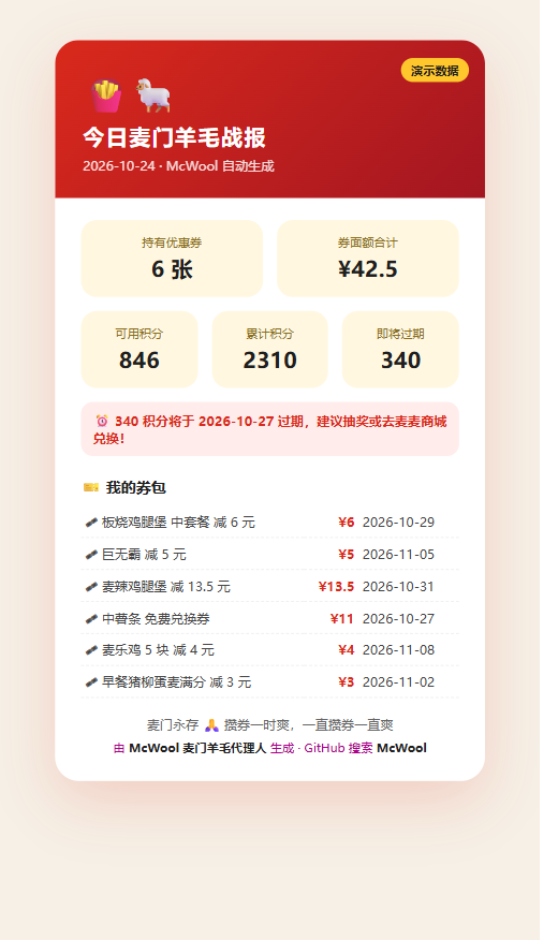

<div align="center">

# 🍟🐑 McWool · 麦门羊毛代理人

**让 AI 替你把麦当劳的羊毛薅干净。**

一键领券 · 积分看护 · 自动抽奖 · 每日羊毛战报

[](https://www.python.org/)
[](https://open.mcd.cn/mcp)
[](./LICENSE)

🎫 参赛项目 ·「麦当劳程序员创意开发大赛」基于麦当劳官方 MCP 构建

</div>

---

## 📖 这是什么？

麦当劳 App 里的羊毛，你是不是经常忘？

- 麦麦省的券**忘了领**，想吃的时候一张都没有
- 积分**默默过期**，从来没抽过奖
- 到底持有哪些券、什么时候到期，**全靠现场翻**

**McWool 是一个替你干活的羊毛代理人**：它不给你"省钱建议"，它直接**动手**——自动领取全部可领优惠券、盯住即将过期的积分、按需自动抽奖，最后生成一张可以晒的**「今日羊毛战报」**卡片。

> 别人算怎么省钱，McWool 直接把羊毛薅到你碗里。🐑



## ✨ 功能

| 命令 | 干什么 | 使用的官方 MCP 工具 |
|---|---|---|
| `daily` | 每日例行：领券 → 积分体检 → 羊毛战报（终端 + HTML 卡片） | `auto-bind-coupons` `query-my-coupons` `query-my-account` |
| `claim` | **一键领取**麦麦省所有可领优惠券 | `auto-bind-coupons` |
| `coupons` | 查看持有的券 + 面额 + 有效期 | `query-my-coupons` |
| `points` | 积分账户体检，**即将过期积分红色预警** | `query-my-account` |
| `lottery` | 查看积分抽奖活动；`--draw N` 自动抽 N 次 | `query-lottery-info` `draw-lottery` |

**亮点**

- 🐑 **真·代理人**：`auto-bind-coupons` 一次把所有可领的券全部领光，不用一张张点
- ⏰ **积分看护**：即将过期的积分红色高亮，提醒你抽奖/兑换，一分不让麦当劳白赚
- 📸 **羊毛战报**：每日生成麦当劳配色的分享卡片，晒到群里就是最好的炫耀
- 🧯 **零依赖跑演示**：没有 Token？`--demo` 模式 3 秒体验全部功能
- 🤖 **双形态**：既是独立 CLI，也提供 `SKILL.md`，接入 WorkBuddy / Cursor 等 Agent 直接对话使唤

## 🚀 30 秒上手

### 第一步：领 Token（免费，约 1 分钟）

1. 打开 https://open.mcd.cn
2. 右上角【登录】→ 手机号验证登录
3. 右上角【控制台】→ 点【激活】→ 同意协议 → **一键复制 MCP Token**

### 第二步：跑起来

```bash
git clone https://github.com/YOUR_GITHUB_NAME/McWool.git
cd McWool
pip install requests          # 唯一依赖

# 先体验一下（无需 Token）
python mcwool.py daily --demo

# 配置 Token（三选一）
export MCD_MCP_TOKEN=你的Token          # Windows CMD: set MCD_MCP_TOKEN=你的Token
python mcwool.py claim --token 你的Token # 或直接传参
echo 你的Token > ~/.mcwool_token        # 或存文件

# 开薅！
python mcwool.py daily
```

终端里你会看到：

```
🐑 第一步 · 一键领券（auto-bind-coupons）
  ✅ 已自动领取 5 张麦麦省优惠券

💰 我的积分（query-my-account）
  可用积分: 846
  ⏰ 注意：340 积分即将过期，建议抽奖或兑换掉！

┌──────────────────────────────────────────────────┐
│              🍟 今日麦门羊毛战报                    │
│  🐑 持有优惠券 6 张，合计价值约 ¥42.5              │
│  ⏰ 提醒: 340 积分 2026-10-27 过期，快抽奖/兑换！   │
│      麦门永存 🙏 攒券一时爽，一直攒券一直爽          │
└──────────────────────────────────────────────────┘
📸 战报卡片已生成: mcwool_report_20261024_2251.html
```

同时生成一张 HTML 战报卡片（自动在浏览器打开），直接截图发朋友圈。

### 进阶：每天自动薅（可选）

```bash
# Windows 任务计划程序 / Linux crontab 每天早上 8 点
0 8 * * * cd /path/to/McWool && python mcwool.py daily >> woollist.log 2>&1
```

积分抽奖要消耗积分，`--draw` 请按需使用（单次上限 10 抽，防止上头）。

## 🤖 作为 Agent Skill 使用（WorkBuddy / Cursor 等）

已在 MCP 客户端接入麦当劳官方 MCP（`https://mcp.mcd.cn`）的用户，可以把本仓库当作 **Skill** 使用：

1. WorkBuddy：左侧【专家·技能·连接器】→【连接器】→【自定义连接器】→【配置 MCP】，粘贴：

```json
{
  "mcpServers": {
    "mcd-mcp": {
      "type": "streamablehttp",
      "url": "https://mcp.mcd.cn",
      "headers": { "Authorization": "Bearer YOUR_MCP_TOKEN" }
    }
  }
}
```

2. 对话框直接说："**按 McWool 的流程帮我薅羊毛**"——Agent 会按 [`SKILL.md`](./SKILL.md) 的流程自动领券、查积分、提示过期、建议抽奖，并生成战报。

## 🧩 它是怎么工作的？

McWool 直连麦当劳官方 MCP Server（Streamable HTTP + JSON-RPC），不逆向、不爬虫、不存任何数据：

```
python mcwool.py daily
        │
        ▼
┌─ auto-bind-coupons ──→ 一键领光麦麦省可领的券
├─ query-my-coupons ───→ 盘点券包（名称/面额/有效期）
├─ query-my-account ───→ 积分体检（可用/累计/即将过期）
└─ 汇总生成 ──────────→ 终端战报 + HTML 分享卡片
```

详见 [`MCP_INTEGRATION.md`](./MCP_INTEGRATION.md)。

## ⚠️ 说明

- 本项目为[麦当劳程序员节创意开发大赛](https://github.com/M-China/mcd-developer-innovation-challenge)参赛作品，非麦当劳官方产品
- Token 只用于访问你自己的账户数据，请妥善保管，**不要提交到仓库**（`.gitignore` 已配置）
- 券信息、积分以麦当劳官方渠道实时结果为准；`lottery --draw` 会真实消耗积分
- 仅供学习交流，请合理控制调用频率（官方限制 600 次/分钟）

## 📄 License

[MIT](./LICENSE)

## 🙏 麦门

如果 McWool 帮你省到了钱，欢迎 **Star** 支持——这是对羊毛代理人最大的鼓励。

**麦门永存。🍔🙏**
